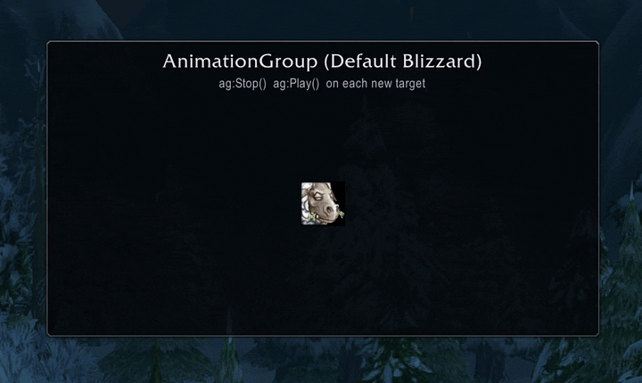
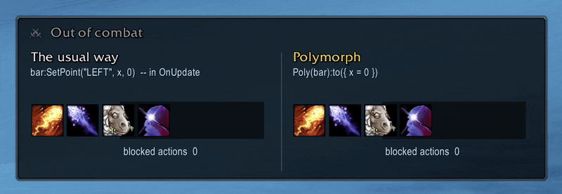
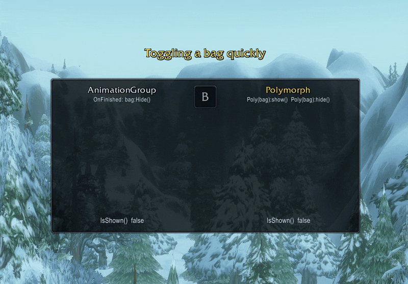
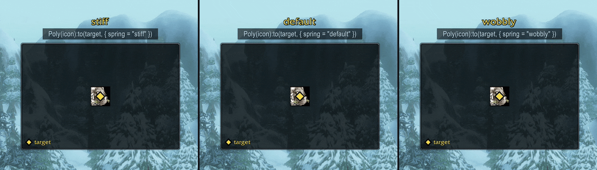
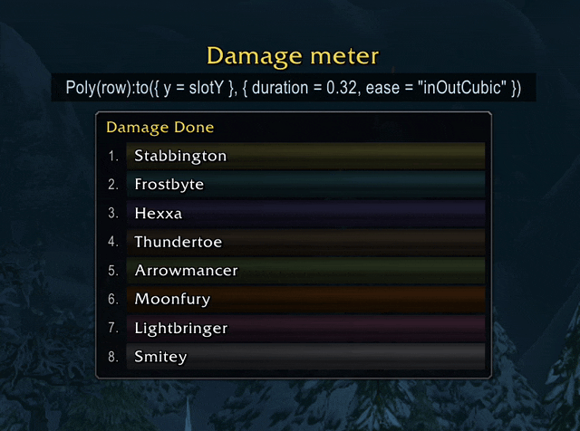
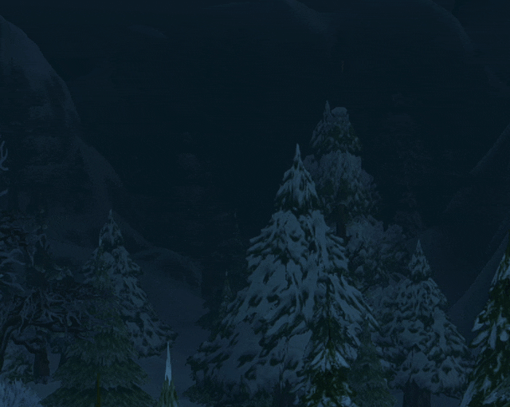

# Polymorph

[](https://github.com/noelcserepy/polymorph/actions/workflows/test.yml)
[](https://github.com/noelcserepy/polymorph/releases)
[](#install)
[](https://www.lua.org/manual/5.1/)
[](LICENSE)

Target-state animation for World of Warcraft addons. Springs, tweens and retargeting, with combat lockdown handled for you.

> **Status: early.** Version 0.1, built for WoW Forever and tested only on its beta (1.60.1, interface 16001). It probably works on retail too, but nobody has tested it there yet. The API may still change.

```lua
local Poly = LibStub("Polymorph-1.0")

Poly(frame):to({ alpha = 1, y = 20 })                          -- spring
Poly(frame):to({ width = 300 }, { duration = 0.25, ease = "outCubic" })
Poly(panel):hide("below")                                      -- animate out, then Hide()
```

## Change the target whenever you like

Call `:to()` again at any time, and the frame continues from where it is. A spring keeps its speed when the target changes, so a frame that follows the mouse, a bar that grows on every event, or a panel that opens and closes quickly never jumps.



The same moving target, twice. An animation group restarted on each new target snaps back, and `Poly(sheep):to()` carries on from where the sheep is.

## Safe on secure frames in combat

In combat, the game blocks `SetPoint`, `SetSize`, `Show` and `Hide` on protected frames, on their parents, and on frames anchored to them. Calling one shows the player an "action blocked" error. Polymorph never makes those calls while the frame is locked.



Combat starts, and two bars of `SecureActionButtonTemplate` buttons should slide into their slots. On the left, an `OnUpdate` calls `bar:SetPoint()`. The game refuses the calls, the bar stays put, and blocked actions climb to 55. On the right, `Poly(bar):to({ x = 0 })` slides the bar in with 0 blocked actions.

| During combat lockdown, on a protected frame | What Polymorph does |
| --- | --- |
| `alpha` | Animates normally. |
| `x`, `y`, `scale` | Animates through paused native animations. When combat ends, the frame is anchored and scaled where it shows. |
| `width`, `height` | Waits, then animates when combat ends. |
| `hide()` | Fades, slides and shrinks now. The real `Hide()` happens when combat ends, and the faded frame still takes clicks until then. |
| `show()` on a hidden frame | Waits for combat to end. |

Everything in this table was tested on `SecureActionButtonTemplate` buttons in real combat, with no blocked actions. That includes a bar that slides in from a `PLAYER_REGEN_DISABLED` handler, as combat locks it.

## Open and close as fast as you like

Calling `show()` during a `hide()` turns the frame around, and `Hide()` is never called. An animation group's fade-out that calls `Hide()` from its `OnFinished` still hides the frame when it ends, even if the player reopened it and a fade-in is playing.



The bag key pressed again mid-fade. On the left, an animation group whose `OnFinished` calls `bag:Hide()` hides the bag the player just reopened, and `IsShown()` reads false. On the right, `Poly(bag):show()` turns the fade around, and the bag stays open.

## Springs that follow anything

Without a `duration`, `:to()` uses a spring. Presets use react-spring's names and values: `default`, `gentle`, `wobbly`, `stiff`, `slow`, `molasses`. You can also pass your own `{ stiffness, damping, mass }`.



The same target path three times, one spring preset each. Every frame, each panel calls `Poly(icon):to(target, { spring = preset })` with the gold diamond's position. The path is scripted. Each spring keeps its speed through every turn and jump.

## Built with it

Two clips of Polymorph in ordinary addon UI.



A damage meter built with Polymorph. Each bar tweens to its new amount on every update, and rows move to their new rank with an `inOutCubic` tween.



A loot window. Rows arrive 30 ms apart with `show()`. A looted row leaves with `hide()`, then the rows below and the window's bottom edge close the gap together.

## Install

Polymorph is a LibStub library in one file. Embed it like any other library.

With the [BigWigs packager](https://github.com/BigWigsMods/packager), add it to your `.pkgmeta`:

```yaml
externals:
  Libs/Polymorph:
    url: https://github.com/noelcserepy/polymorph
    tag: latest
```

Then load it after LibStub in your TOC or `embeds.xml`:

```xml
<Include file="Libs\Polymorph\lib.xml"/>
```

To copy it in by hand, `Polymorph.lua` and `lib.xml` are all you need, plus LibStub.

## What you can animate

| Property | What it changes | Notes |
| --- | --- | --- |
| `alpha` | `SetAlpha` | Clamped to 0..1. |
| `x`, `y` | `SetPoint` offsets | Moves every anchor of the frame by the same offset. Anchors that other code sets between animations become the frame's home. |
| `width`, `height` | `SetWidth`, `SetHeight` | One `SetSize` when both move. |
| `scale` | `SetScale` | Scale also scales anchor offsets. To grow around the center, anchor the frame at offset 0 inside a holder. |

Animate several properties in one call. Each one moves on its own track.

`Poly()` takes frames, textures and font strings. Combat rules follow each one's own `IsProtected()`. On a `SecureActionButtonTemplate` button, its texture and font string report `IsProtected()` false before and during combat. Layout and visibility calls on its texture and its font string in combat raised 0 blocked actions.

Layouts, frame pools and frame movers, such as AceGUI-3.0, ScrollBox, `CreateFramePool` and LibWindow-1.1, write to the same frames. Polymorph passed in-game tests that share frames with each of these, and with LibDBIcon-1.0, LibCustomGlow and Blizzard's fader. [Using Polymorph with other code](docs/api.md#using-polymorph-with-other-code) says how Polymorph shares a frame with them: anchors, pools, two-anchor frames, and alpha that a fader also writes.

An error from a game call on one frame starts only that frame over, and every other frame keeps animating. During a call such as `to()`, the error goes to that call's caller. Otherwise it reaches the game's error handler once, as does an error in an `onComplete`, which stops nothing.

### Your own values

Polymorph has no built-in color, counter or typewriter. It gives you `define()` to make your own. Define values on a handle, and animate them like any property. Polymorph calls your writer once per update with every current value:

```lua
local r, g, b = icon:GetVertexColor()
Poly(icon):define({ r = r, g = g, b = b }, function(tex, c) tex:SetVertexColor(c.r, c.g, c.b) end)
Poly(icon):to({ r = 1, g = 0.2, b = 0.2 }, { duration = 0.3 })
```

Names you define belong to that one handle, so addons sharing Polymorph can't collide. [`docs/api.md`](docs/api.md#mdefinevalues-write-opts) has the rules and three reference examples to copy and adapt: a number counter that rolls to each new total, a typewriter, and a color fade.

## Springs and tweens

Without a `duration`, `:to()` uses a spring (see [Springs that follow anything](#springs-that-follow-anything)). With a `duration`, it tweens. Easings: `linear`, `inSine`, `outSine`, `inOutSine`, `inQuad`, `outQuad`, `inOutQuad`, `outCubic` (the default), `inOutCubic`, `ease`, `easeOut`, `easeInOut`. Any CSS-style cubic-bezier works too:

```lua
Poly(f):to({ x = 120 }, { duration = 0.4, ease = { 0.34, 1.56, 0.64, 1 } }) -- overshoots
```

Every call takes `delay` and `onComplete`. That covers staggered lists and chained steps:

```lua
for i, row in ipairs(rows) do
  Poly(row):to({ alpha = 1, y = 0 }, { spring = "wobbly", delay = (i - 1) * 0.03 })
end
```

## Show and hide

```lua
Poly(f):show("pop")      -- from alpha 0 and scale 0.92 to rest
Poly(f):hide("below")    -- slide down and fade, then Hide()
```

Presets name where the frame is while it's away: `fade`, `pop`, `below`, `above`, `left`, `right`. You can also pass a table such as `{ alpha = 0, x = 120 }`. When a hide finishes, every property that `show()` or `hide()` still owns is back at rest, so a plain `Show()` later looks normal. A property you take over with `to()`, `set()` or `stop()` stays the way you left it, and the hide still finishes.

## Performance

One shared `OnUpdate` drives every animation, and it switches itself off when nothing moves. Polymorph creates no timers per animation. That matters because the game caps each addon at 500 timers. In a test with 200 frames animating three properties each (600 springs at once), the driver used 0.89 ms of Lua time per frame, the median of 7 runs. A typical addon animates a few dozen properties at a time.

Tweens of `alpha`, `x` or `y` with `linear`, `inSine`, `outSine` or `inOutSine` run as the game's own animations, with no Lua per frame. These four are the curves the game has built in. Such a tween holds its start value for one frame, then one shared timer starts it. Started from an `OnUpdate` script, the game sometimes drew a sliding frame's first frames far outside its path.

## Reference

[`docs/api.md`](docs/api.md) has every function, option and preset.

## For coding agents

[`skills/polymorph/SKILL.md`](skills/polymorph/SKILL.md) teaches an agent to use Polymorph: setup, the rules that prevent the common bugs, the API, and patterns to copy. Agents that support skills load it on their own when addon code animates frames. Copy the `skills/polymorph` folder into your project or user skills folder:

- Claude Code: `.claude/skills/` in the addon's repository, or `~/.claude/skills/`.
- Codex and other agents that read `.agents/skills/`: that folder in the repository, or `~/.agents/skills/`.

For any other agent, paste the file into its instructions.

## License

[MIT](LICENSE)
